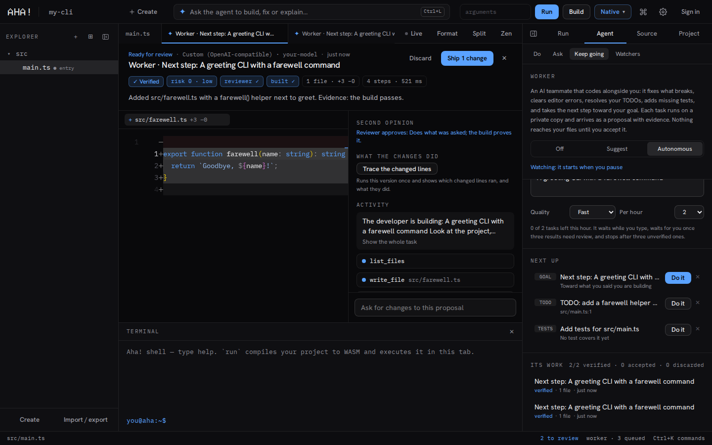

# Aha!

**The AI IDE that proves its work.** Cursor's agent, Zed's speed, Remix's web3 tools and VS Code's reach in one
editor: every AI change arrives as a reviewable proposal that's already been built, run and tested. 40+ languages.

[](https://github.com/BrandDeb/Aha/actions/workflows/ci.yml)
[](https://github.com/BrandDeb/Aha/actions/workflows/desktop.yml)
[](LICENSE)



## Features

- **Editor.** Monaco with project-wide TypeScript, a terminal, Git, and live values: what each line evaluated to on
  the last run, written next to the code. A debugger with breakpoints, stepping and watches for TypeScript and
  Python. VS Code colour themes and snippets install from Open VSX (read, never run).
- **Agent.** Each task runs on a copy of the project and ends as a proposal with its diff, build and test results,
  a risk score and a review by a second model. You accept all of it, part of it, or none.
- **Background work.** The worker takes on follow-up tasks while you pause. Watchers run a task on a schedule, when
  files change or when something fails. Both work through proposals and stay within budgets you set.
- **Languages.** 40+ runtimes with toolchains installed on demand, Python through uv, and TypeScript compiled to a
  native binary through [scriptc](https://scriptc.dev).
- **Web apps.** Templates, an app gallery and a stack builder, with live preview in the browser or on a local dev
  server.
- **Connectors.** Any MCP server (a catalog of 52 is built in), GitHub, SQL databases and web search, plus agent
  skills.
- **Smart contracts.** Solidity compile and static analysis, an in-page EVM, and deploys through a browser wallet.
- **Your models.** Bring your own key for any major provider, or run local models (Ollama, LM Studio).
- **Desktop and server.** Native apps for Windows and macOS, a Docker image, and a server that binds to localhost
  by default.

## Quick start

Requires Node.js 24 or newer. Native builds also need clang on the `PATH`; `npm install` brings zig for WebAssembly.

```bash
git clone https://github.com/BrandDeb/Aha.git
cd Aha
npm install
npm run dev        # http://localhost:3000
```

Nothing has to be configured: each user picks a model in the studio. Copy `.env.example` to `.env.local` only for
GitHub sign-in or a hosted default model.

With Docker:

```bash
docker compose up -d
```

Desktop builds for Windows and macOS are published on the
[releases page](https://github.com/BrandDeb/Aha/releases/tag/desktop-latest).

## Documentation

| Document | What it covers |
|---|---|
| [Guide](docs/guide.md) | Every feature, configuration, the HTTP API and the architecture. Also served by the studio at `/docs`. |
| [Overview](docs/OVERVIEW.md) | How the code fits together, how work is done here, and current status. Start here as a contributor. |
| [Roadmap](docs/ROADMAP.md) | Specs for what comes next. |
| [Backlog](docs/BACKLOG.md) | Everything planned or done, with status. |
| [Security](SECURITY.md) | Threat model, protections, and how to report a vulnerability. |

## Development

```bash
npm run dev          # the studio, restarted on crash
npm test             # unit tests (Node's test runner)
npm run lint
npm run typecheck
npm run build        # production build; also regenerates /docs from docs/guide.md
```

| Path | Contents |
|---|---|
| `src/app/` | Pages and API routes (Next.js) |
| `src/workspace/` | The studio: layout, panels, project state, proposals |
| `src/lib/` | Everything behind the routes: agent, connectors, runners, templates |
| `src-tauri/` | Desktop app (Tauri) |
| `tests/` | Unit tests, one file per area |
| `docs/` | Guide, overview, roadmap, backlog |

Aha! was called NanoCLI Studio until October 2026. Saved settings, projects and `NANOCLI_*` variables carry over
automatically.

## Contributing

Contributions are by invitation. See [CONTRIBUTING.md](CONTRIBUTING.md).

## License

Proprietary. See [LICENSE](LICENSE).
